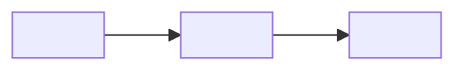

# Design: <nome da feature>

## Visão Geral

<O que existe hoje, as restrições e quais requisitos (IDs) este design atende.>

## Arquitetura

<Componentes, responsabilidades e onde cada um vive no repositório.>

## Componentes e Contratos

| Componente | Interface pública (assinatura, entradas, saídas, erros) | Requisitos |
| :--- | :--- | :--- |
| <módulo ou classe> | <assinatura e contrato> | <1.1, 1.2> |

## Modelo de Dados

<Tipos, campos e esquemas. Apenas o que os requisitos exigem.>

## Tratamento de Erros

<Modos de falha, como cada um é sinalizado (código de saída, exceção, mensagem) e o que é registrado em log sem dados sensíveis.>

## Decisões

Toda decisão tomada com o usuário entra aqui na hora, com data. Decisão revista não é apagada: marque-a como substituída e aponte a nova.

| ID | Decisão (uma frase) | Data | Motivo e quem decidiu | Alternativa descartada e motivo |
| :--- | :--- | :--- | :--- | :--- |
| D1 | <decisão> | <AAAA-MM-DD> | <motivo; usuário, evidência ou regra do harness> | <alternativa> - <por que foi descartada> |

## Segurança

Modelo de ameaças desta mudança (OWASP LLM, ASI e MCP, mais os riscos clássicos de injeção e controle de acesso). Uma linha por ameaça que a mudança realmente carrega; o checklist é a regra `ai-security.md`.

| Ameaça (ID OWASP) | Vetor nesta mudança | Controle | Gate ou teste que verifica |
| :--- | :--- | :--- | :--- |
| LLM01 injeção de prompt indireta | <onde texto não confiável entra no contexto> | <o que impede que vire instrução> | <gate ou teste> |
| LLM02 vazamento de segredo ou PII | <onde dados sensíveis podem sair> | <controle> | <gate ou teste> |
| ASI02 / ASI03 agência ou privilégio excessivo | <ferramentas ou permissões envolvidas> | <controle> | <gate ou teste> |
| MCP03 / MCP09 ferramenta envenenada ou servidor não aprovado | <superfície MCP tocada> | <controle> | <gate ou teste> |

Considerado e não coberto: <ameaça> - <motivo para ficar fora desta mudança>.

## Estratégia de Testes

| Critério de Aceite | Tipo de teste | Teste planejado | Observações |
| :--- | :--- | :--- | :--- |
| 1.1 | Unitário | <test_comportamento_condicao> | <fakes, fixtures sintéticas, tmp_path> |
| 1.2 | Unitário | <test_comportamento_condicao> | <cenário de erro> |
